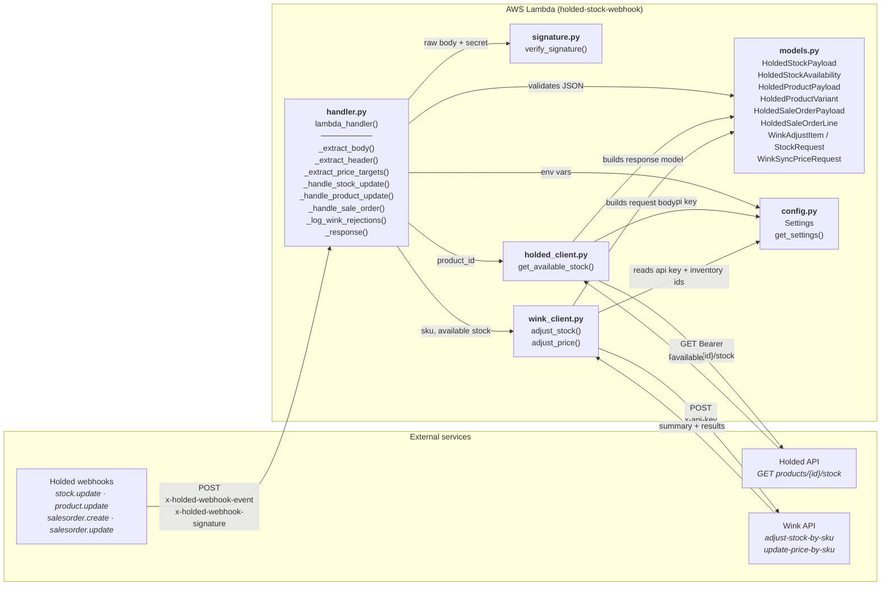
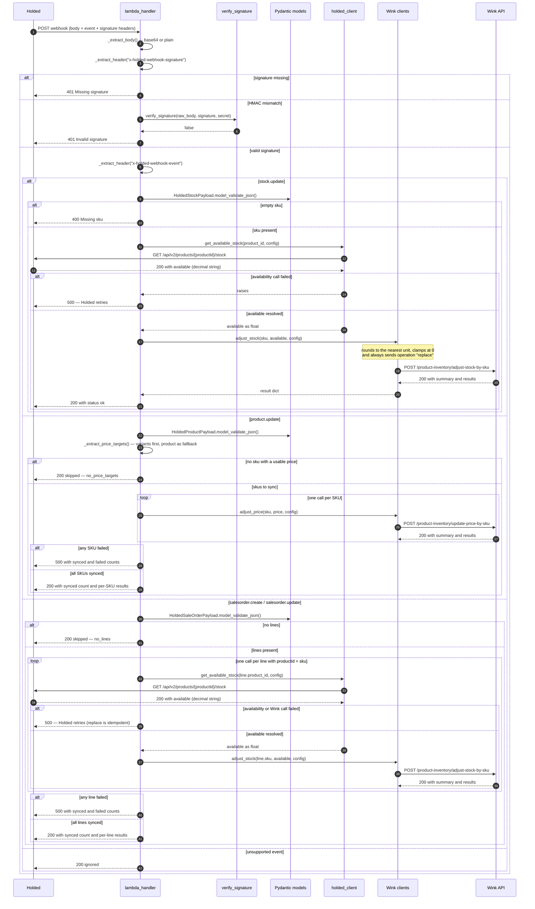
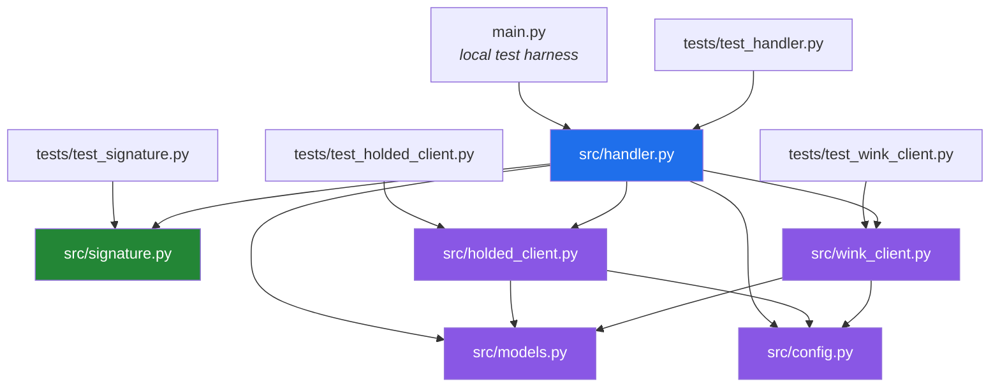
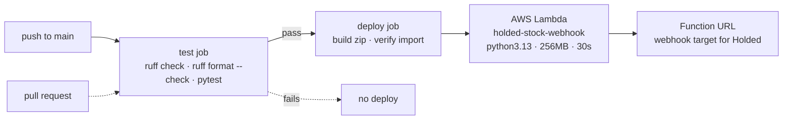

# Holded Stock Webhook

AWS Lambda that syncs stock changes from [Holded](https://www.holded.com/) to [Wink](https://www.winktienda.com/) via their APIs.

When a product's stock is updated in Holded, a `stock.update` webhook fires and this Lambda sets the stock on Wink to Holded's `available` stock (read back from the Holded API), via the `adjust-stock-by-sku` endpoint. Sales orders (`salesorder.create` / `salesorder.update`) are listened to as well, so the stock reserved by a sale keeps Wink in sync even when no `stock.update` event fires.

## Architecture



### Event routing

| `x-holded-webhook-event` | Action | Wink endpoint |
|--------------------------|--------|---------------|
| `stock.update` | Read the product's `available` stock from the Holded API, then set the SKU's stock to it via `replace` | `adjust-stock-by-sku` |
| `product.update` | Push `price` for each SKU | `update-price-by-sku` |
| `salesorder.create` · `salesorder.update` | For each line's product, read `available` from the Holded API, then set the line's SKU stock to it via `replace` | `adjust-stock-by-sku` |
| anything else | `200 {"status": "ignored"}` | — |

Signature verification runs **before** routing, so an unsigned or tampered event never reaches either Wink call.

### Request flow



### Module dependencies



Interactive versions of these diagrams (event flow, stock-sync sequence, and module dependencies) live in [`.documentation/diagrams/`](.documentation/diagrams/), indexed in [`.documentation/README.md`](.documentation/README.md).

## Project Structure

```
src/
├── config.py         # Settings loaded from environment variables
├── holded_client.py  # httpx client: get_available_stock() reads Holded's `available`
├── models.py         # Pydantic models (Holded payloads, Wink requests)
├── signature.py      # HMAC-SHA256 webhook signature verification
├── wink_client.py    # httpx clients: adjust_stock() and adjust_price()
└── handler.py        # AWS Lambda entry point + event routing
tests/
├── test_handler.py       # routing, auth, stock + price + sale order paths, error handling
├── test_holded_client.py # availability endpoint and error propagation
├── test_signature.py     # HMAC verification
└── test_wink_client.py   # replace mapping and price sync
main.py              # Builds signed sample events and calls lambda_handler
```

## Prerequisites

- [Python 3.13+](https://www.python.org/downloads/)
- [uv](https://docs.astral.sh/uv/) (package manager)

## Setup

```bash
# Clone the repo
git clone <repo-url>
cd holded-stock-webhook

# Install dependencies
uv sync
```

## Environment Variables

Create a `.env` file from the example:

```bash
cp .env.example .env
```

| Variable | Description |
|----------|-------------|
| `HOLDED_WEBHOOK_SECRET` | Webhook signing secret from Holded (`whsec_...`) |
| `HOLDED_API_KEY` | Holded API key, sent as `Bearer` to read product availability |
| `WINK_API_KEY` | API key from Wink Backoffice (API & Webhooks section) |
| `WINK_INVENTORY_IDS` | Comma-separated Wink inventory/sede IDs (e.g. `12`) |

## Testing

### Run all tests

```bash
uv run pytest tests/ -v
```

### Run a specific test file

```bash
uv run pytest tests/test_signature.py -v
uv run pytest tests/test_handler.py -v
uv run pytest tests/test_holded_client.py -v
uv run pytest tests/test_wink_client.py -v
```

### Run a specific test by name

```bash
uv run pytest tests/ -v -k "test_valid_signature"
uv run pytest tests/ -v -k "test_add_stock"
```

### Run tests with coverage

```bash
uv run pytest tests/ --cov=src --cov-report=term-missing
```

> **Note:** To run the coverage command, add `pytest-cov` to the dev dependencies in `pyproject.toml`.

### Lint and format

```bash
# Check lint
uv run ruff check src/ tests/ main.py

# Auto-fix lint issues
uv run ruff check --fix src/ tests/ main.py

# Check formatting
uv run ruff format --check src/ tests/ main.py

# Apply formatting
uv run ruff format src/ tests/ main.py
```

### Test locally

You can invoke the Lambda handler directly to verify it works end-to-end with real credentials:

```bash
uv run python main.py
```

This runs `main.py` which builds a sample event and calls `lambda_handler`. Make sure your `.env` file is configured before running.

## Webhook Behaviour

1. Holded fires a `stock.update`, `product.update`, `salesorder.create` or `salesorder.update` webhook.
2. The Lambda verifies the HMAC-SHA256 signature before doing anything else.
3. It routes on the `x-holded-webhook-event` header.
4. `stock.update` → reads the product's `available` stock from the Holded API and **sets** the Wink stock for the SKU to that value, via the `replace` operation of `adjust-stock-by-sku`.
5. `product.update` → pushes `price` per SKU via `update-price-by-sku`.
6. `salesorder.create` / `salesorder.update` → iterates the order's `lines` and, for each line that names a product, reads that product's `available` stock from the Holded API and **sets** the line's SKU in Wink to that value via `replace`.
7. Any other event is acknowledged with `200 {"status": "ignored"}` so Holded does not retry it.

### Observability

Every invocation logs the full event received from Holded (headers and body) via `logger.info` at the top of `lambda_handler`, so the raw payload is available in CloudWatch Logs — including unsupported events and lines that were skipped.

### Stock sync rules

The sync is **absolute, not a delta**: every `stock.update` — whatever its
`action` — tells Wink to *set* the existence of the SKU to the stock Holded
reports:

- **Which value**: `available` from `GET /api/v2/products/{productId}/stock`,
  Holded's sellable stock (total minus stock reserved by pending sales orders),
  read with the `productId` the webhook already carries. The payload's
  `calculatedStock`/`calculatedVariantStock` are ignored. `available` is
  product-level, so a variant movement pushes the parent product's availability
  too — Wink may then reject the parent SKU with `product_has_variants`.
- **Which operation**: always `replace`. Re-sending the same value is
  idempotent, so Holded's automatic retries and the Wink↔Holded feedback loop
  (a Wink sale lowering stock in both systems) need no guard: the value simply
  lands on the same number again.
- **Normalisation**: the quantity is rounded to the nearest unit and clamped at
  0, since Wink requires an integer ≥ 0 and would reject the whole request
  otherwise. A stock of 0 is still sent — it means *agotado*.
- **Empty `sku`** returns `400`, checked before the availability lookup.
- **Sale order events** (`salesorder.create` / `salesorder.update`) run the same per-product flow as `stock.update`: for each line carrying a `productId` and a `sku`, the product's `available` is read from the Holded API and the line's SKU stock is set to it with `replace`. Lines without a product or SKU (e.g. free-text lines) are skipped with a warning; a sale order with no lines at all answers `200 {"status": "skipped", "reason": "no_lines"}`.
- **Holded availability failure** (401/404/timeout, bad payload) returns `500`
  so Holded retries the delivery instead of leaving Wink out of sync.
- Wink answers `200` even when an individual adjustment failed
  (`sku_not_found`, `product_has_variants`, `negative_result`, …). Those rows
  are logged as warnings and the delivery still returns `200`: a retry would
  not fix them, and Holded would otherwise retry forever.

### Price sync rules

- `price` arrives from Holded as a string (`"12.50"`) and is coerced to `float`.
- Variants win over the product: if any variant has a SKU and a price, only variants are synced. The product-level `sku`/`price` is used only as a fallback.
- SKUs that are empty, duplicated within the event, or have a `null`/negative price are dropped.
- Prices are absolute, so a Holded retry re-applies already-synced SKUs harmlessly.

### Response codes

| Status | When |
|--------|------|
| `200` | Stock set, prices synced, sale order lines synced, or skipped (`no_price_targets`, `no_lines`, `ignored`) |
| `400` | `stock.update` payload has an empty `sku` |
| `401` | Signature header missing or HMAC mismatch |
| `500` | Unhandled error, failed Holded availability lookup, at least one SKU failed during `product.update`, or at least one line failed during a sale order event |

## Deploying

Deployment is handled by `.github/workflows/deploy.yaml`.



The `test` job runs on every push and pull request. The `deploy` job has `needs: test`, so it only runs when the checks pass and only on `main` (never on pull requests). It can also be triggered manually with **Actions → CI/CD → Run workflow**.

### Required repository secrets

| Secret | Value |
|--------|-------|
| `AWS_ACCESS_KEY_ID` | IAM key with permission to update the Lambda |
| `AWS_SECRET_ACCESS_KEY` | Same IAM key's secret |
| `LAMBDA_ROLE_ARN` | Execution role ARN, only used when the function is first created |
| `HOLDED_WEBHOOK_SECRET` | Same value as `HOLDED_WEBHOOK_SECRET` in your local `.env` |
| `HOLDED_API_KEY` | Same value as `HOLDED_API_KEY` in your local `.env` |
| `WINK_API_KEY` | Same value as `WINK_API_KEY` in your local `.env` |
| `WINK_INVENTORY_IDS` | Same value as `WINK_INVENTORY_IDS` in your local `.env` |

A missing secret fails the run with an explicit `::error::` message rather than deploying a broken function.

### What the deploy job does

1. Exports and installs production dependencies into `build/package` and copies `src/` alongside them.
2. Zips it (about 3 MB) and asserts that `src.handler.lambda_handler` imports from the built package, so a wrong handler path fails in CI instead of in production.
3. Creates the function on first run, or updates code and configuration on later runs.
4. Creates or updates the Function URL and makes it publicly invokable, then prints the URL.

The Lambda has no `.env` file: pydantic-settings reads `HOLDED_WEBHOOK_SECRET`, `HOLDED_API_KEY`, `WINK_API_KEY` and `WINK_INVENTORY_IDS` from the function's environment variables, which the workflow sets from the secrets above. Register the printed URL in Holded for the `stock.update`, `product.update`, `salesorder.create` and `salesorder.update` events.

The function URL uses `--auth-type NONE`, so requests are unauthenticated at the transport level. The HMAC signature check in the handler is the actual authentication, so `HOLDED_WEBHOOK_SECRET` must be set both in Holded and in the Lambda.


## License

MIT
